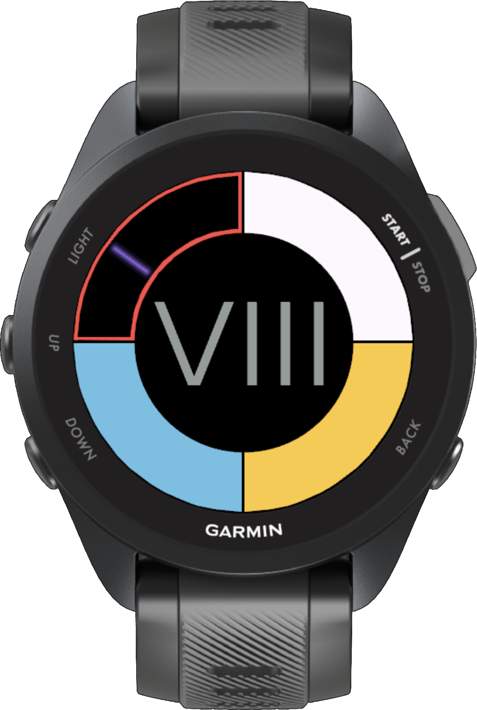

# Lazytime

A Garmin Connect IQ watch face showing the 12-hour hour in Roman numerals and cumulative 15-minute intervals. A glowing seconds marker moves while the watch is awake and is hidden in low-power mode.



The hour uses M PLUS U Regular, licensed under the SIL Open Font License 1.1; the font and license are in `resources/fonts/`.

The initial target is the Forerunner 570 42mm, matching Counterclock. Build with the Connect IQ SDK and a developer key:

```sh
monkeyc -f monkey.jungle -o bin/Lazytime.prg -y /path/to/developer_key -d fr57042mm -w
```